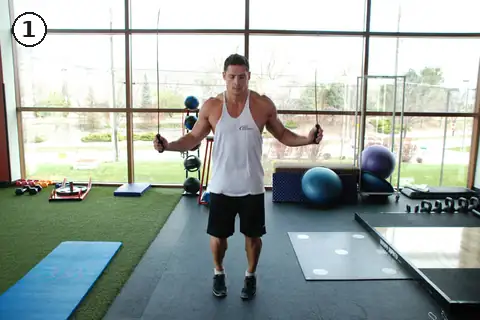

# Seilspringen (auch ohne Seil)

> Klein und locker auf den Ballen springen, Handgelenke kreisen.

- **Muskeln/Bereich:** Kondition, Waden
- **Equipment:** Körpergewicht
- **Kategorie:** Kondition
- **Erfassung:** Sekunden (Halten)

## Kommt vor in

- [Vorlage Lockeres Cardio daheim](../ablaeufe/vorlagen/x-cardio.md)
