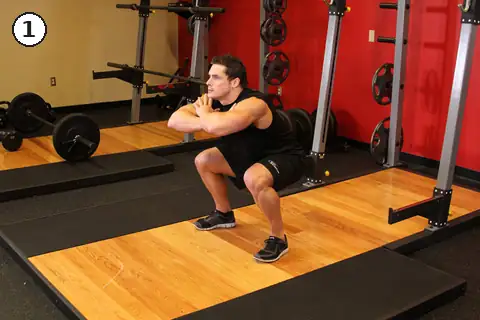

# Sprungkniebeugen

> Halbtief beugen, explosiv abspringen, weich landen.

- **Muskeln/Bereich:** Beine, Schnellkraft
- **Equipment:** Körpergewicht, Calisthenics
- **Kategorie:** Beine und Po
- **Erfassung:** Körpergewicht, Wiederholungen

## Kommt vor in

- [Vorlage Tabata Ganzkörper](../ablaeufe/vorlagen/x-tabata.md)
