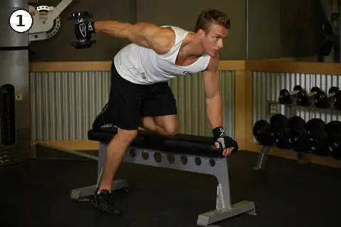

# Trizeps-Kickbacks

> Wie beim einarmigen Rudern abstützen, Oberarm parallel zum Boden, Unterarm nach hinten strecken.

- **Muskeln/Bereich:** Trizeps
- **Equipment:** Kurzhanteln, Bank
- **Kategorie:** Arme
- **Erfassung:** Gewicht und Wiederholungen, Steigerung 2 kg
- **Pro Seite** ausführen
