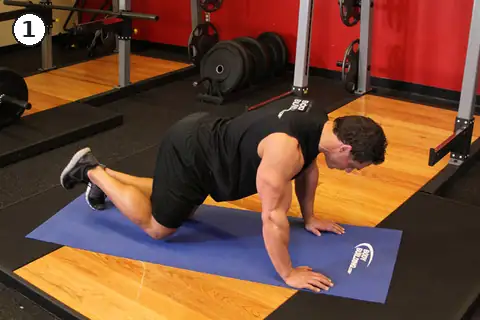

# Po-Kickback im Vierfüßler

> Vierfüßlerstand, ein Bein gebeugt nach hinten oben drücken, Rücken bleibt gerade.

- **Muskeln/Bereich:** Po
- **Equipment:** Körpergewicht
- **Kategorie:** Beine und Po
- **Erfassung:** Körpergewicht, Wiederholungen
- **Pro Seite** ausführen
