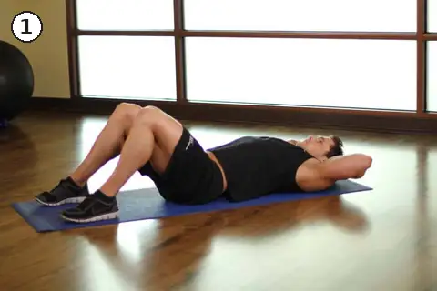

# Ein Knie zur Brust

> Rückenlage, ein Knie zur Brust, anderes Bein lang am Boden.

- **Muskeln/Bereich:** Po, unterer Rücken
- **Equipment:** Körpergewicht
- **Kategorie:** Mobility
- **Erfassung:** Sekunden (Halten)

## Kommt vor in

- [Mobility nach Gefühl: Po](../mobility/koerperbereiche.md)
