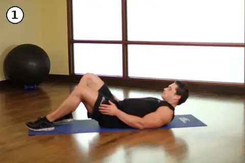

# Knie zur Brust

> Rückenlage, beide Knie umarmen und sanft zur Brust ziehen.

- **Muskeln/Bereich:** Unterer Rücken
- **Equipment:** Körpergewicht
- **Kategorie:** Mobility
- **Erfassung:** Sekunden (Halten)

## Kommt vor in

- [Mobility nach Gefühl: Unterer Rücken](../mobility/koerperbereiche.md)
