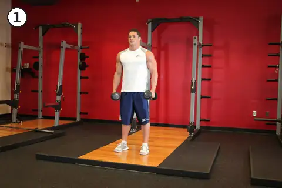

# Seitheben

> Leicht, kein Schwung, bis Schulterhöhe.

- **Muskeln/Bereich:** Schultern
- **Equipment:** Kurzhanteln
- **Kategorie:** Schultern
- **Erfassung:** Gewicht und Wiederholungen, Steigerung 1 kg
- **Hantel:** zwei Kurzhanteln

## Ausführung

- Leicht nach vorn geneigt, Knie weich.
- Ellbogen minimal gebeugt, führen die Bewegung.
- Arme seitlich bis Schulterhöhe heben, kleine Finger leicht höher.
- Schultern bleiben tief, Hals entspannt.
- 2 s ablassen.

## Häufige Fehler

- Schwung aus dem Oberkörper.
- Schultern ziehen zu den Ohren.

## Atmung

Ausatmen beim Heben.

## Wo du es spürst

Seitliche Schulter.

## Kommt vor in

- [Vorlage Oberkörper Drücken](../ablaeufe/vorlagen/x-push.md)
- [Vorlage Arme und Schultern](../ablaeufe/vorlagen/x-arms.md)
