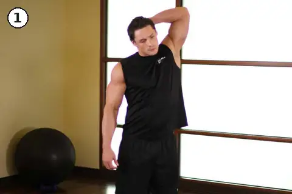

# Seitneige im Stand

> Arme über Kopf, Hände verschränkt, langsam zur Seite neigen.

- **Muskeln/Bereich:** Flanke
- **Equipment:** Körpergewicht
- **Kategorie:** Mobility
- **Erfassung:** Sekunden (Halten)
