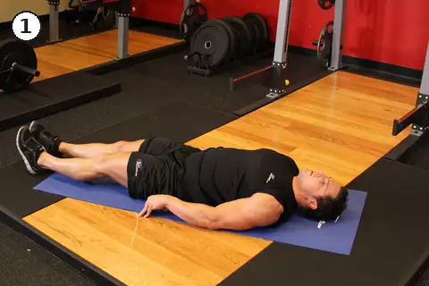

# Knie zur Brust sitzend

> Auf den Unterarmen zurückgelehnt, Knie zur Brust ziehen und Beine wieder strecken.

- **Muskeln/Bereich:** Bauch
- **Equipment:** Körpergewicht
- **Kategorie:** Core
- **Erfassung:** Körpergewicht, Wiederholungen
