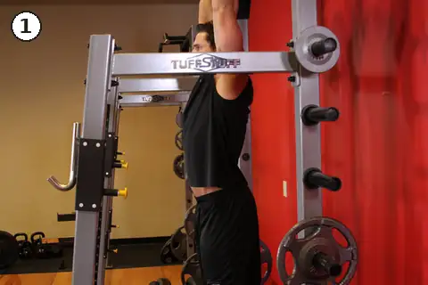

# Hängendes Beinheben gestreckt

> Gestreckte Beine bis mindestens waagerecht heben, Becken einrollen, nicht schwingen.

- **Muskeln/Bereich:** Core (unten), Hüftbeuger
- **Equipment:** Klimmzugstange, Calisthenics
- **Kategorie:** Core
- **Erfassung:** Körpergewicht, Wiederholungen
- **Braucht die Klimmzugstange**

## Kommt vor in

- [Vorlage Core an der Stange](../ablaeufe/vorlagen/x-core2.md)
- [Skill Toes to Bar, Stufe 2](../skills/t2b.md)
