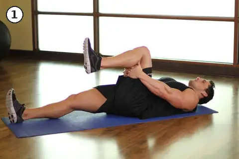

# Beinbeuger-Dehnung im Liegen

> Rückenlage, ein Bein gestreckt nach oben, mit Händen oder Band halten.

- **Muskeln/Bereich:** Beinbeuger
- **Equipment:** Körpergewicht
- **Kategorie:** Mobility
- **Erfassung:** Sekunden (Halten)

## Kommt vor in

- [Mobility nach Gefühl: Oberschenkel hinten](../mobility/koerperbereiche.md)
