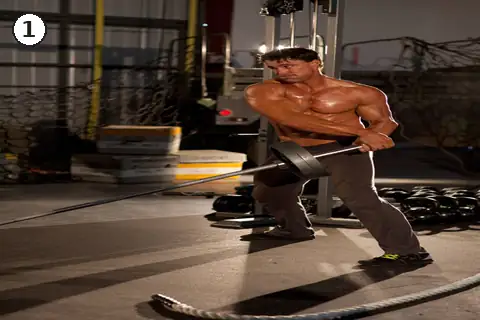

# Landmine-Rotation

> Arme fast gestreckt, Stangenende im Bogen von Hüfte zu Hüfte führen. Drehung kommt aus Hüfte und Füßen, Rumpf bleibt fest.

- **Muskeln/Bereich:** Core (Rotation), Schultern
- **Equipment:** Langhantel, Unkonventionell
- **Kategorie:** Core
- **Erfassung:** Körpergewicht, Wiederholungen

## Kommt vor in

- [Vorlage Landmine und Unkonventionell](../ablaeufe/vorlagen/x-land.md)
