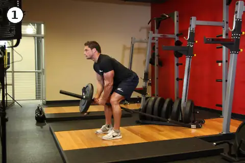

# Landmine-Rudern (T-Bar)

> Über der Stange stehen, direkt hinter den Scheiben greifen (Handtuch um die Stange), Rücken gerade, zur Brust ziehen.

- **Muskeln/Bereich:** Rücken
- **Equipment:** Langhantel, Unkonventionell
- **Kategorie:** Rücken
- **Erfassung:** Gewicht und Wiederholungen, Steigerung 2.5 kg

## Kommt vor in

- [Vorlage Landmine und Unkonventionell](../ablaeufe/vorlagen/x-land.md)
