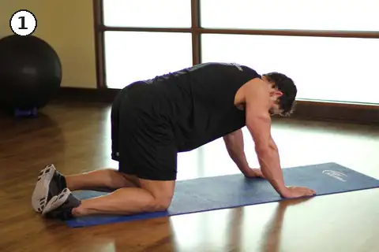

# Halbe Heuschrecke

> Bauchlage, ein Knie beugen und den Fuß zum Po ziehen.

- **Muskeln/Bereich:** Hüftbeuger, Oberschenkel vorn
- **Equipment:** Körpergewicht
- **Kategorie:** Mobility
- **Erfassung:** Sekunden (Halten)
