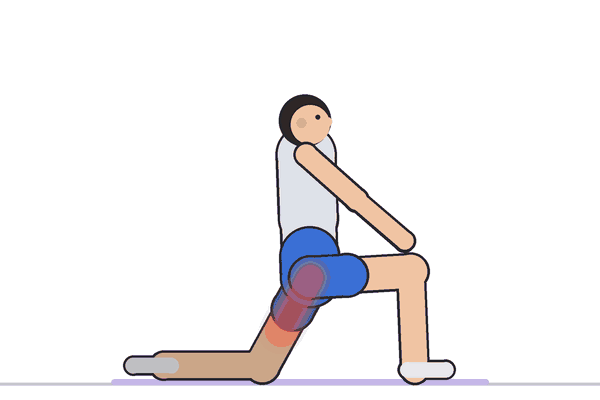

# Tiefer Ausfallschritt

> Hinteres Knie ablegen, Becken nach vorn unten sinken lassen, Po anspannen, Arme nach oben.

- **Muskeln/Bereich:** Hüftbeuger
- **Equipment:** Körpergewicht
- **Kategorie:** Mobility
- **Erfassung:** Sekunden (Halten)

## Ausführung

- Vorderes Knie über dem Sprunggelenk, hinteres Knie weich abgelegt.
- Becken sinkt nach vorn unten, Steißbein zeigt zum Boden.
- Po des hinteren Beins aktiv anspannen.
- Arme nach oben, Rippen bleiben unten, kein Hohlkreuz.
- Optional mit der Hüfte leicht vor und zurück wippen, dann halten.

## Häufige Fehler

- Ins Hohlkreuz kippen, um tiefer zu kommen.
- Vorderes Knie fällt nach innen.

## Atmung

Einatmen: Arme hoch und lang. Ausatmen: Becken sinkt.

## Wo du es spürst

Vorne in der Leiste des hinteren Beins, bis in den Oberschenkel.

## Kommt vor in

- [Yoga-Flow · 20 min](../ablaeufe/gefuehrt/yoga20.md)
- [Yoga · 30 min](../ablaeufe/gefuehrt/yoga30.md)
- [Mobility nach Gefühl: Hüfte und Hüftbeuger](../mobility/koerperbereiche.md)
- [Yoga nach Gefühl](../mobility/yoga-baukasten.md)
- [Skill Frontspagat, Stufe 1](../skills/spagat.md)
