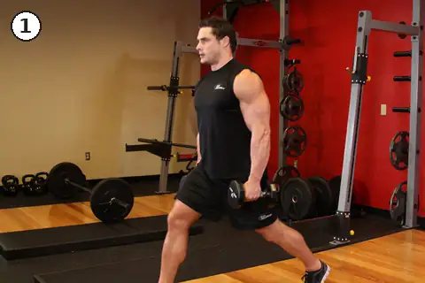

# Ausfallschritte gehend

> Großer Schritt, hinteres Knie fast bis zum Boden.

- **Muskeln/Bereich:** Oberschenkel, Po
- **Equipment:** Kurzhanteln
- **Kategorie:** Beine und Po
- **Erfassung:** Gewicht und Wiederholungen, Steigerung 2 kg
- **Hantel:** zwei Kurzhanteln

## Ausführung

- Großer Schritt.
- Knie über dem Fuß.
- Oberkörper aufrecht.

## Häufige Fehler

- Knie fällt nach innen.

## Atmung

Ausatmen beim Hochdrücken.

## Wo du es spürst

Oberschenkel und Po.
