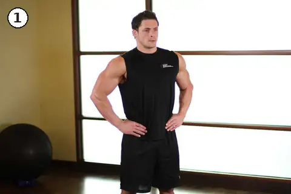

# Drehung im Stand

> Hände an der Hüfte, Oberkörper langsam zu jeder Seite drehen.

- **Muskeln/Bereich:** Mittlerer Rücken
- **Equipment:** Körpergewicht
- **Kategorie:** Mobility
- **Erfassung:** Sekunden (Halten)

## Kommt vor in

- [Mobility nach Gefühl: Oberer Rücken](../mobility/koerperbereiche.md)
