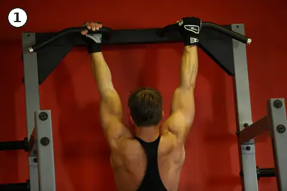

# Klimmzüge Mischgriff

> Eine Hand Obergriff, eine Untergriff. Seiten pro Satz wechseln.

- **Muskeln/Bereich:** Rücken, Bizeps
- **Equipment:** Klimmzugstange, Calisthenics
- **Kategorie:** Rücken
- **Erfassung:** Körpergewicht, Wiederholungen
- **Braucht die Klimmzugstange**
