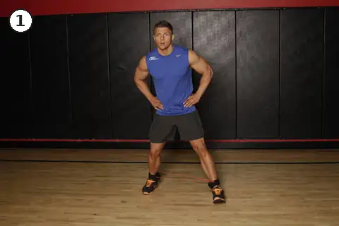

# Monster Walk

> Band um Knie oder Füße, leichte Hocke, seitlich und diagonal gehen. Knie bleiben außen.

- **Muskeln/Bereich:** Po außen
- **Equipment:** Bänder
- **Kategorie:** Beine und Po
- **Erfassung:** Band, Wiederholungen
