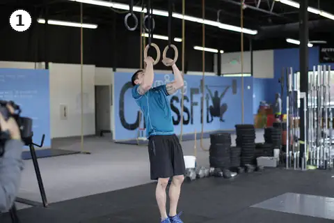

# Muscle-up

> Explosiver Klimmzug bis zur Hüfte, über die Stange kippen und hochdrücken. Erst mit 10 sauberen Klimmzügen angehen.

- **Muskeln/Bereich:** Rücken, Brust, Trizeps
- **Equipment:** Klimmzugstange, Calisthenics
- **Kategorie:** Rücken
- **Erfassung:** Körpergewicht, Wiederholungen
- **Braucht die Klimmzugstange**
