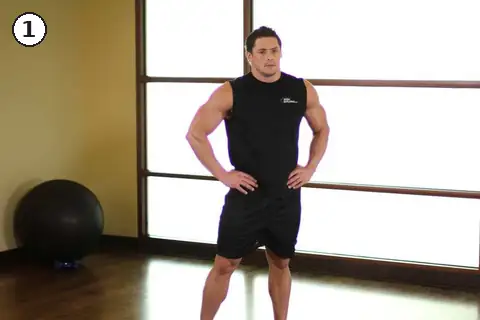
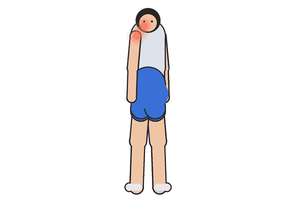

# Nacken-Seitneigung

> Aufrecht stehen oder sitzen. Ohr langsam Richtung Schulter sinken lassen, die andere Schulter zieht nach unten. Nicht ziehen, nur halten und atmen.

- **Muskeln/Bereich:** Nacken
- **Equipment:** Körpergewicht
- **Kategorie:** Mobility
- **Erfassung:** Sekunden (Halten)

## Ausführung

- Aufrecht sitzen oder stehen, Scheitel lang nach oben.
- Ohr langsam Richtung Schulter sinken lassen, Nase zeigt nach vorn.
- Die Gegenschulter aktiv nach unten schieben, Hand ggf. unter den Po klemmen.
- Für mehr Dehnung den Kopf leicht nach vorn unten drehen (Nase zur Achsel).

## Häufige Fehler

- Die Schulter zum Ohr hochziehen.
- Mit der Hand am Kopf ziehen.

## Atmung

Ins Ziehen hineinatmen, beim Ausatmen sinkt der Kopf von allein.

## Wo du es spürst

Seitlich am Hals bis in die obere Schulter.

## Kommt vor in

- [Mobility nach Gefühl: Nacken](../mobility/koerperbereiche.md)
- [Yoga nach Gefühl](../mobility/yoga-baukasten.md)
