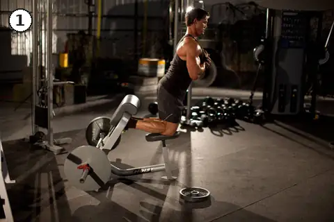

# Nordic Curls

> Kniend, Fersen unter Bank oder Sofa fixiert. Körper gerade, so langsam wie möglich nach vorn ablassen, mit den Händen abfangen.

- **Muskeln/Bereich:** Beinbeuger
- **Equipment:** Bank, Calisthenics, Unkonventionell
- **Kategorie:** Beine und Po
- **Erfassung:** Körpergewicht, Wiederholungen

## Kommt vor in

- [Vorlage Beine und Po](../ablaeufe/vorlagen/x-legs.md)
- [Vorlage Calisthenics Beine](../ablaeufe/vorlagen/x-clegs.md)
