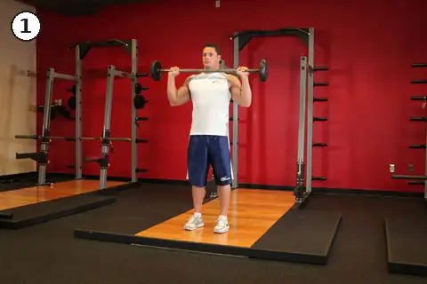

# Schulterdrücken stehend

> Po und Bauch fest, Kopf nach der Stange durchschieben.

- **Muskeln/Bereich:** Schultern, Trizeps
- **Equipment:** Langhantel
- **Kategorie:** Schultern
- **Erfassung:** Gewicht und Wiederholungen, Steigerung 2.5 kg
- **Hantel:** Langhantel

## Ausführung

- Griff knapp schulterbreit, Stange auf der vorderen Schulter.
- Po und Bauch fest, Rippen unten.
- Kopf kurz zurück, Stange gerade nach oben drücken.
- Oben Kopf durch die Arme schieben, Stange über der Fußmitte.

## Häufige Fehler

- Hohlkreuz, um das Gewicht hochzubekommen.
- Stange vor dem Körper nach vorn drücken.

## Atmung

Einatmen und Bauch fest vor jeder Wiederholung, oben ausatmen.

## Wo du es spürst

Schultern und Trizeps, Rumpf hält.

## Kommt vor in

- [Kraft B · Beine](../ablaeufe/kraft-b.md)
- [Skill Handstand-Liegestütz, Stufe 1](../skills/hspu.md)
- [Skill Überkopfdrücken, Stufe 1](../skills/ohp.md)
- [Skill Überkopfdrücken, Stufe 2](../skills/ohp.md)
- [Skill Überkopfdrücken, Stufe 3](../skills/ohp.md)
- [Skill Überkopfdrücken, Stufe 4](../skills/ohp.md)
