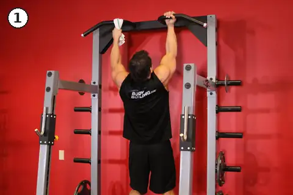

# Einarmiger Klimmzug

> Endziel: freie Hand anfangs am Handgelenk. Vorher Archer und Negative üben.

- **Muskeln/Bereich:** Rücken, Bizeps, Griff
- **Equipment:** Klimmzugstange, Calisthenics
- **Kategorie:** Rücken
- **Erfassung:** Körpergewicht, Wiederholungen
- **Pro Seite** ausführen
- **Braucht die Klimmzugstange**
