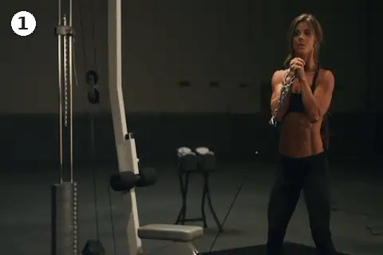

# Pallof Press

*Hinweis zum Foto: Foto am Kabelzug, mit Band gleich.*

> Band seitlich auf Brusthöhe. Rumpf dreht nicht mit, vorne 2 s halten.

- **Muskeln/Bereich:** Core (Anti-Rotation)
- **Equipment:** Bänder
- **Kategorie:** Core
- **Erfassung:** Band, Wiederholungen
- **Pro Seite** ausführen

## Ausführung

- Seitlich zum Ankerpunkt, Füße schulterbreit, Knie weich.
- Band auf Brusthöhe, Hände an der Brust.
- Arme gerade nach vorn drücken, der Rumpf bleibt frontal.
- Vorne 2 s halten, langsam zurück.

## Häufige Fehler

- Oberkörper dreht zum Band.
- Hohlkreuz.

## Atmung

Ausatmen beim Rausdrücken.

## Wo du es spürst

Seitliche Bauchmuskeln.

## Kommt vor in

- [Kraft A](../ablaeufe/kraft-a.md)
- [Vorlage Core Stabilität](../ablaeufe/vorlagen/x-core1.md)
