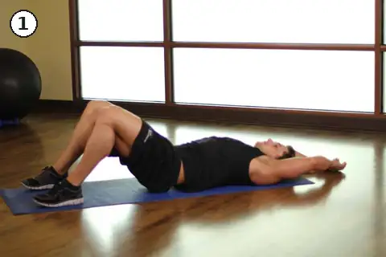

# Becken kippen bis zur Brücke

> Rückenlage, Becken einrollen und Wirbel für Wirbel zur Brücke heben und abrollen.

- **Muskeln/Bereich:** Unterer Rücken, Po
- **Equipment:** Körpergewicht
- **Kategorie:** Mobility
- **Erfassung:** Sekunden (Halten)

## Kommt vor in

- [Mobility nach Gefühl: Unterer Rücken](../mobility/koerperbereiche.md)
