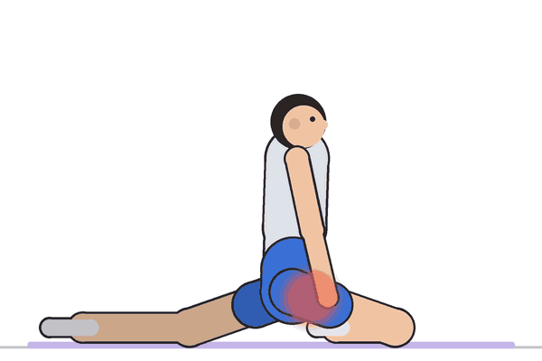

# Taube

> Vorderes Schienbein quer, hinteres Bein lang. Erst aufrecht, dann mit dem Oberkörper nach vorn ablegen.

- **Muskeln/Bereich:** Po, Hüfte außen
- **Equipment:** Körpergewicht
- **Kategorie:** Mobility
- **Erfassung:** Sekunden (Halten)

## Ausführung

- Vorderes Schienbein möglichst quer, je steifer die Hüfte, desto näher die Ferse zur Leiste.
- Vorderen Fuß aktiv anziehen, das schützt das Knie.
- Hinteres Bein lang nach hinten, Zehen zeigen gerade nach unten.
- Becken gerade ausrichten: Kissen unter die Po-Seite des vorderen Beins, wenn sie schwebt.
- Erst aufrecht, dann mit langem Rücken auf Unterarme oder Stirn ablegen.

## Häufige Fehler

- Becken kippt zur Seite des vorderen Beins.
- Schmerz im vorderen Knie: Fuß näher zur Hüfte oder Figur-4 im Liegen nehmen.

## Atmung

Tief in den Bauch, mit jedem Ausatmen etwas weiter sinken.

## Wo du es spürst

Ziehen tief im Po und an der Hüftaußenseite des vorderen Beins.

## Kommt vor in

- [Yoga-Flow · 20 min](../ablaeufe/gefuehrt/yoga20.md)
- [Yoga · 30 min](../ablaeufe/gefuehrt/yoga30.md)
- [Mobility nach Gefühl: Hüfte und Hüftbeuger](../mobility/koerperbereiche.md)
- [Mobility nach Gefühl: Po](../mobility/koerperbereiche.md)
- [Yoga nach Gefühl](../mobility/yoga-baukasten.md)
