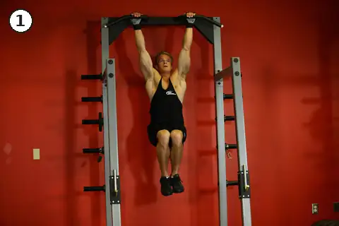

# Hängendes Hechten

> Gestreckte Beine bis zur Stange heben, langsam ablassen. Kein Schwung.

- **Muskeln/Bereich:** Core, Hüftbeuger
- **Equipment:** Klimmzugstange, Calisthenics
- **Kategorie:** Core
- **Erfassung:** Körpergewicht, Wiederholungen
- **Braucht die Klimmzugstange**
