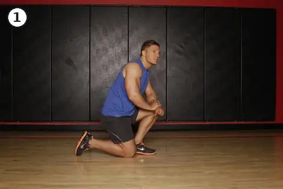
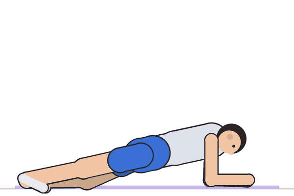

# Unterarmstütz

> Ganzkörperspannung, Po nicht hoch.

- **Muskeln/Bereich:** Core
- **Equipment:** Körpergewicht
- **Kategorie:** Core
- **Erfassung:** Sekunden (Halten)

## Ausführung

- Ellbogen unter den Schultern, Unterarme parallel.
- Körper eine Linie von Kopf bis Ferse.
- Po anspannen und Becken leicht einrollen.
- Ellbogen gedanklich zu den Zehen ziehen, Bauch wird fester.
- Blick zum Boden, Nacken lang.

## Häufige Fehler

- Po hoch oder Hüfte hängt durch.
- Schultern sinken zwischen die Schulterblätter.

## Atmung

Kurz und ruhig weiteratmen, nicht pressen.

## Wo du es spürst

Bauch und Po arbeiten, nicht der untere Rücken.

## Kommt vor in

- [Einstieg](../ablaeufe/gefuehrt/warmup.md)
- [Yoga nach Gefühl](../mobility/yoga-baukasten.md)
- [Skill Einarmiger Liegestütz, Stufe 1](../skills/einarmliege.md)
- [Skill Rollout mit der Langhantel, Stufe 1](../skills/rollout.md)
