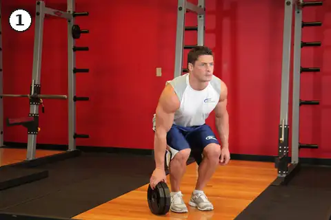

# Scheiben-Pinchgriff

> Zwei glatte Scheiben aneinander mit den Fingern zusammenkneifen und halten.

- **Muskeln/Bereich:** Griff, Unterarme
- **Equipment:** Unkonventionell
- **Kategorie:** Arme
- **Erfassung:** Sekunden (Halten)

## Kommt vor in

- [Skill Griffkraft, Stufe 1](../skills/griff.md)
