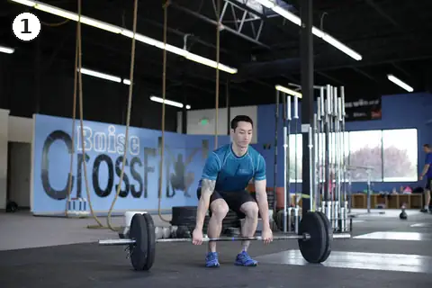

# Umsetzen (Power Clean)

> Aus der Kreuzheben-Position die Hüfte explosiv strecken, Stange eng am Körper, unter die Stange tauchen und auf den Schultern fangen.

- **Muskeln/Bereich:** Ganzkörper, Schnellkraft
- **Equipment:** Langhantel
- **Kategorie:** Ganzkörper
- **Erfassung:** Gewicht und Wiederholungen, Steigerung 2.5 kg
- **Hantel:** Langhantel

## Kommt vor in

- [Skill Umsetzen (Power Clean), Stufe 2](../skills/umsetzen.md)
- [Skill Umsetzen (Power Clean), Stufe 3](../skills/umsetzen.md)
- [Skill Umsetzen (Power Clean), Stufe 4](../skills/umsetzen.md)
