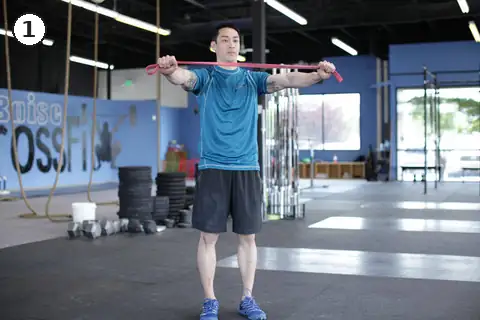
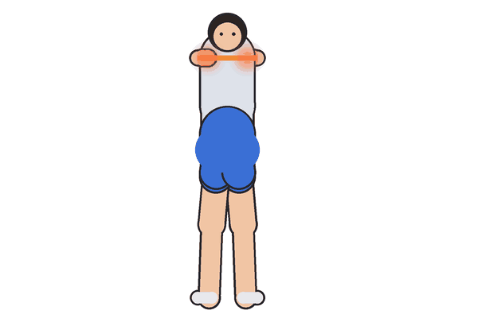

# Band Pull-Aparts

> Arme gestreckt, Band auf Brusthöhe auseinanderziehen.

- **Muskeln/Bereich:** Hintere Schulter
- **Equipment:** Bänder
- **Kategorie:** Schultern
- **Erfassung:** Sekunden (Halten)

## Ausführung

- Band auf Brusthöhe, Hände schulterbreit, Arme fast gestreckt.
- Schultern tief und von den Ohren weg.
- Band auseinanderziehen, bis es die Brust berührt, Schulterblätter zusammen.
- Langsam zurück, 2 s für den Rückweg.

## Häufige Fehler

- Ins Hohlkreuz ausweichen.
- Ellbogen stark beugen und mit dem Bizeps ziehen.

## Atmung

Ausatmen beim Auseinanderziehen.

## Wo du es spürst

Arbeit zwischen den Schulterblättern und hinten an der Schulter.

## Kommt vor in

- [Einstieg](../ablaeufe/gefuehrt/warmup.md)
- [Mobility nach Gefühl: Schultern und Brust](../mobility/koerperbereiche.md)
- [Skill Schulterbeweglichkeit, Stufe 2](../skills/schulter.md)
