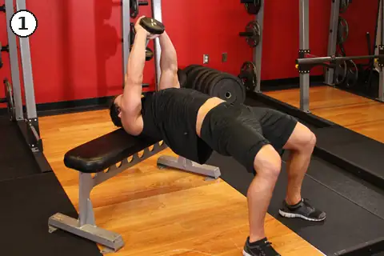

# Überzüge

> Quer auf der Bank, Rippen unten lassen.

- **Muskeln/Bereich:** Lat, Brust
- **Equipment:** Kurzhanteln, Bank
- **Kategorie:** Rücken
- **Erfassung:** Gewicht und Wiederholungen, Steigerung 2 kg

## Ausführung

- Quer auf der Bank, Schultern aufgelegt, Hüfte tief.
- Hantel mit beiden Händen über der Brust.
- Mit leicht gebeugten Armen hinter den Kopf absenken.
- Rippen bleiben unten.

## Häufige Fehler

- Hohlkreuz beim Absenken.

## Atmung

Einatmen beim Absenken, ausatmen beim Zurückholen.

## Wo du es spürst

Lat und Brust.

## Kommt vor in

- [Kraft C](../ablaeufe/kraft-c.md)
- [Skill Front-Lever-Vorstufen, Stufe 3](../skills/frontlever.md)
