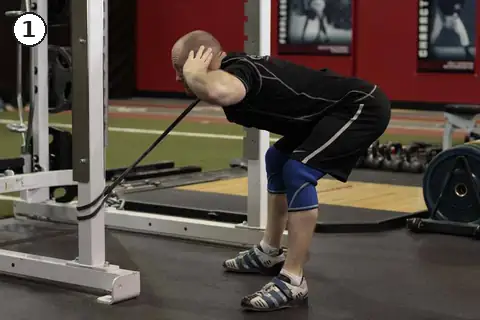

# Pull-through mit Band

> Rücken zum Befestigungspunkt, Band zwischen den Beinen. Hüfte nach hinten, dann mit dem Po kräftig nach vorn strecken.

- **Muskeln/Bereich:** Po, Beinbeuger
- **Equipment:** Bänder
- **Kategorie:** Beine und Po
- **Erfassung:** Band, Wiederholungen
