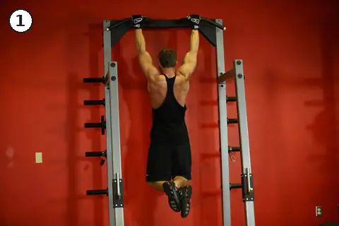

# Klimmzüge Obergriff

> Zu schwer: Band als Hilfe. Volle Streckung unten.

- **Muskeln/Bereich:** Rücken, Bizeps
- **Equipment:** Klimmzugstange, Calisthenics
- **Kategorie:** Rücken
- **Erfassung:** Körpergewicht, Wiederholungen
- **Braucht die Klimmzugstange**

## Ausführung

- Griff etwas breiter als schulterbreit.
- Aus dem toten Hang erst die Schulterblätter nach unten ziehen.
- Brust zur Stange, Ellbogen zu den Hüften führen.
- Beine leicht vor dem Körper, Bauch fest, kein Schwung.
- Unten wieder ganz strecken.

## Häufige Fehler

- Halbe Wiederholungen.
- Kinn reckt sich nach vorn über die Stange.
- Schwingen mit den Beinen.

## Atmung

Ausatmen beim Hochziehen, einatmen beim Ablassen.

## Wo du es spürst

Breiter Rücken, Bizeps.

## Kommt vor in

- [Kraft A](../ablaeufe/kraft-a.md)
- [Vorlage Oberkörper Ziehen](../ablaeufe/vorlagen/x-pull.md)
- [Vorlage Calisthenics Ziehen und Skills](../ablaeufe/vorlagen/x-cpull.md)
- [Skill Klimmzug, Stufe 3](../skills/klimmzug.md)
- [Skill Klimmzug, Stufe 4](../skills/klimmzug.md)
- [Skill Klimmzug, Stufe 5](../skills/klimmzug.md)
- [Skill Klimmzug, Stufe 6](../skills/klimmzug.md)
- [Skill Muscle-up, Stufe 1](../skills/muscleup.md)
- [Skill Muscle-up, Stufe 2](../skills/muscleup.md)
- [Skill Muscle-up, Stufe 4](../skills/muscleup.md)
- [Skill Muscle-up, Stufe 5](../skills/muscleup.md)
