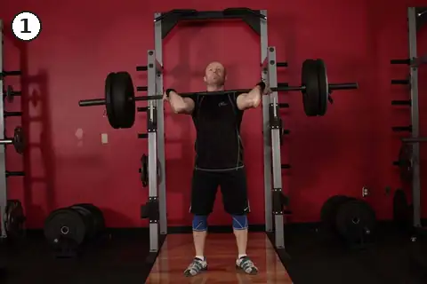

# Push Press

> Stange auf den Schultern (vorher umsetzen). Kurz in die Knie, mit dem Beinschwung explosiv über Kopf drücken.

- **Muskeln/Bereich:** Schultern, Trizeps, Beine
- **Equipment:** Langhantel
- **Kategorie:** Schultern
- **Erfassung:** Gewicht und Wiederholungen, Steigerung 2.5 kg
- **Hantel:** Langhantel
