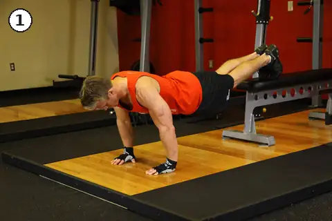

# Liegestütze, Füße erhöht

> Füße auf der Bank, Hände aufs Brett. Ab 20 Wdh. Rucksack.

- **Muskeln/Bereich:** Brust, Trizeps
- **Equipment:** Liegestützbrett, Bank, Körpergewicht
- **Kategorie:** Brust
- **Erfassung:** Körpergewicht, Wiederholungen

## Ausführung

- Hände etwas breiter als die Schultern.
- Körper eine Linie, Po und Bauch fest.
- Ellbogen ca. 45° zum Körper.
- Brust bis knapp über den Boden.

## Häufige Fehler

- Hüfte hängt durch.
- Kopf zuerst zum Boden.

## Atmung

Einatmen beim Absenken, ausatmen beim Drücken.

## Wo du es spürst

Brust und Trizeps.

## Kommt vor in

- [Kraft C](../ablaeufe/kraft-c.md)
- [Skill Einarmiger Liegestütz, Stufe 2](../skills/einarmliege.md)
