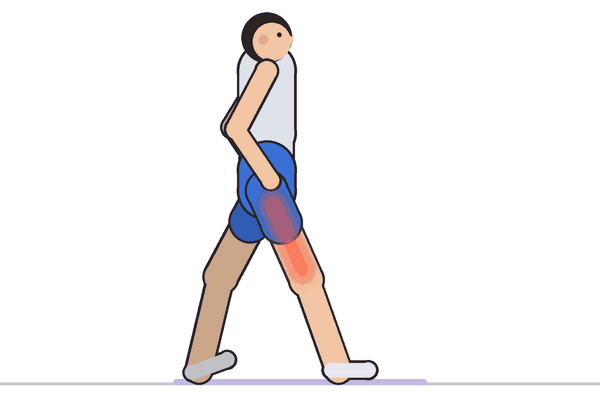

# Pyramide

> Beide Beine gestreckt, Hüfte zeigt nach vorn. Mit langem Rücken über das vordere Bein beugen.

- **Muskeln/Bereich:** Beinbeuger
- **Equipment:** Körpergewicht
- **Kategorie:** Mobility
- **Erfassung:** Sekunden (Halten)

## Ausführung

- Schrittstellung etwa ein Bein lang, beide Füße flach, hinterer Fuß ca. 45° gedreht.
- Beide Hüftknochen zeigen nach vorn wie Scheinwerfer.
- Beine gestreckt, aber Knie nicht durchdrücken.
- Aus der Hüfte mit langem Rücken nach vorn kippen, Hände auf Blöcke oder Schienbein.
- Erst wenn der Rücken lang bleibt, darf der Oberkörper weiter sinken.

## Häufige Fehler

- Rücken rund ziehen, um tiefer zu kommen.
- Hüfte des hinteren Beins dreht auf.

## Atmung

Einatmen: Rücken lang. Ausatmen: aus der Hüfte etwas tiefer.

## Wo du es spürst

Dehnung in der Beinrückseite des vorderen Beins.

## Kommt vor in

- [Yoga · 30 min](../ablaeufe/gefuehrt/yoga30.md)
- [Mobility nach Gefühl: Oberschenkel hinten](../mobility/koerperbereiche.md)
- [Yoga nach Gefühl](../mobility/yoga-baukasten.md)
- [Skill Frontspagat, Stufe 1](../skills/spagat.md)
- [Skill Frontspagat, Stufe 2](../skills/spagat.md)
- [Skill Vorbeuge, Stufe 1](../skills/vorbeuge.md)
- [Skill Vorbeuge, Stufe 3](../skills/vorbeuge.md)
