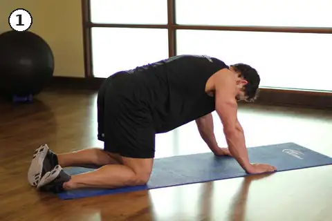

# Oberschenkel-Dehnung im Vierfüßler

> Aus dem Vierfüßler einen Fuß greifen und die Ferse zum Po ziehen.

- **Muskeln/Bereich:** Oberschenkel vorn
- **Equipment:** Körpergewicht
- **Kategorie:** Mobility
- **Erfassung:** Sekunden (Halten)
