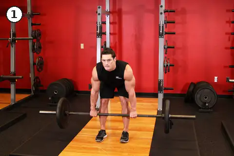

# Rumänisches Kreuzheben

> Knie leicht gebeugt, Hüfte nach hinten, Stange am Bein entlang.

- **Muskeln/Bereich:** Beinbeuger, Po
- **Equipment:** Langhantel
- **Kategorie:** Beine und Po
- **Erfassung:** Gewicht und Wiederholungen, Steigerung 2.5 kg
- **Hantel:** Langhantel

## Ausführung

- Hüftbreiter Stand, Knie leicht gebeugt und fest.
- Hüfte nach hinten schieben wie beim Schließen einer Tür mit dem Po.
- Stange gleitet an den Oberschenkeln entlang.
- Rücken bleibt neutral, Lat angespannt.
- Runter bis knapp unter das Knie oder bis der Rücken rund würde.

## Häufige Fehler

- Knie zu stark beugen: wird zur Kniebeuge.
- Stange weg vom Bein.
- Runder Rücken unten.

## Atmung

Einatmen beim Absenken, ausatmen beim Hochkommen.

## Wo du es spürst

Beinrückseite und Po.

## Kommt vor in

- [Kraft C](../ablaeufe/kraft-c.md)
- [Skill Vorbeuge, Stufe 1](../skills/vorbeuge.md)
- [Skill Kreuzheben, Stufe 1](../skills/kreuzheben.md)
- [Skill Kreuzheben, Stufe 2](../skills/kreuzheben.md)
- [Skill Umsetzen (Power Clean), Stufe 2](../skills/umsetzen.md)
