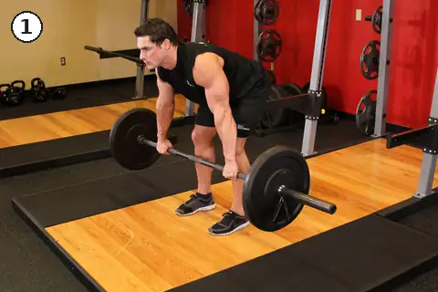

# Rudern zur Brust, weite Ellbogen

> Vorgebeugt wie beim Rudern, weiter Griff. Stange zur unteren Brust ziehen, Ellbogen zeigen nach außen. Leichter als normales Rudern.

- **Muskeln/Bereich:** Hintere Schulter, oberer Rücken
- **Equipment:** Langhantel
- **Kategorie:** Schultern
- **Erfassung:** Gewicht und Wiederholungen, Steigerung 2.5 kg
- **Hantel:** Langhantel
