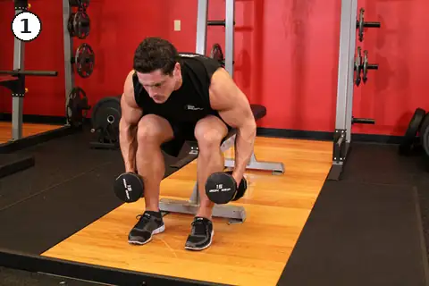

# Vorgebeugtes Seitheben

> Oberkörper vorgebeugt, Arme leicht gebeugt seitlich heben. Leicht und kontrolliert.

- **Muskeln/Bereich:** Hintere Schulter
- **Equipment:** Kurzhanteln
- **Kategorie:** Schultern
- **Erfassung:** Gewicht und Wiederholungen, Steigerung 1 kg
- **Hantel:** zwei Kurzhanteln

## Kommt vor in

- [Vorlage Oberkörper Ziehen](../ablaeufe/vorlagen/x-pull.md)
