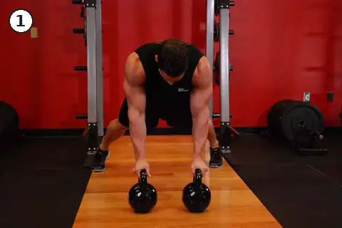

# Renegade Row

*Hinweis zum Foto: Foto mit Kettlebell, Ablauf mit Kurzhantel gleich.*

> Anfangs kniend (Stufe 1). Hüfte bleibt ruhig.

- **Muskeln/Bereich:** Core, Rücken
- **Equipment:** Kurzhanteln
- **Kategorie:** Core
- **Erfassung:** Sekunden (Halten)

## Ausführung

- Stütz auf den Hanteln, Füße breit.
- Hüfte bleibt waagerecht.
- Ellbogen zur Hüfte ziehen.

## Häufige Fehler

- Hüfte dreht auf.

## Atmung

Ausatmen beim Ziehen.

## Wo du es spürst

Rumpf und Rücken.

## Kommt vor in

- [Vorlage Kurzhantel-Kondition](../ablaeufe/vorlagen/x-dbcond.md)
- [Kondition + Core-Zirkel](../ablaeufe/gefuehrt/circuit.md)
