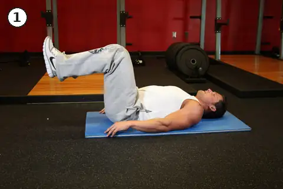

# Reverse Crunch auf der Bank

> Ersatz ohne Stange: Hände hinter dem Kopf an der Bank, Becken einrollen, langsam ablassen.

- **Muskeln/Bereich:** Core
- **Equipment:** Bank
- **Kategorie:** Core
- **Erfassung:** Körpergewicht, Wiederholungen

## Ausführung

- Rückenlage, Hände halten die Bank hinter dem Kopf.
- Knie 90°, Becken einrollen und vom Boden heben.
- Langsam Wirbel für Wirbel ablassen.

## Häufige Fehler

- Schwung mit den Beinen.

## Atmung

Ausatmen beim Einrollen.

## Wo du es spürst

Unterer Bauch.

## Kommt vor in

- [Kraft A](../ablaeufe/kraft-a.md) (Ersatz)
- [Skill Toes to Bar, Stufe 1](../skills/t2b.md)
- [Skill Dragon Flag, Stufe 1](../skills/dragonflag.md)
