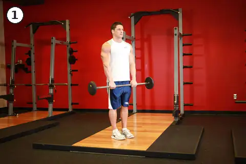

# Reverse Curls

> Obergriff, Ellbogen am Körper. Trifft Unterarme und Oberarmmuskel.

- **Muskeln/Bereich:** Bizeps, Unterarme
- **Equipment:** SZ-Stange
- **Kategorie:** Arme
- **Erfassung:** Gewicht und Wiederholungen, Steigerung 2.5 kg
- **Hantel:** SZ-Stange

## Ausführung

- Obergriff, Ellbogen am Körper.
- Handgelenke gerade halten.
- Langsam ablassen.

## Häufige Fehler

- Handgelenke knicken ab.

## Atmung

Ausatmen beim Hochbeugen.

## Wo du es spürst

Unterarme und Oberarm.

## Kommt vor in

- [Kraft B · Beine](../ablaeufe/kraft-b.md) (Variante)
