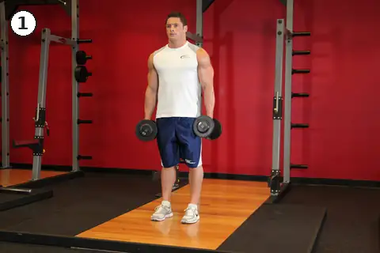

# Ausfallschritt rückwärts im Stand

> Auf der Stelle: großer Schritt zurück, hinteres Knie fast zum Boden, zurück in den Stand. Braucht kaum Platz.

- **Muskeln/Bereich:** Oberschenkel, Po
- **Equipment:** Kurzhanteln
- **Kategorie:** Beine und Po
- **Erfassung:** Gewicht und Wiederholungen, Steigerung 1 kg
- **Hantel:** zwei Kurzhanteln
- **Pro Seite** ausführen

## Ausführung

- Großer Schritt zurück.
- Vorderes Knie bleibt über dem Fuß.
- Oberkörper aufrecht, Rumpf fest.
- Hinteres Knie fast bis zum Boden.

## Häufige Fehler

- Knie fällt nach innen.
- Oberkörper kippt nach vorn.

## Atmung

Ausatmen beim Hochdrücken.

## Wo du es spürst

Oberschenkel und Po.

## Kommt vor in

- [Kraft C](../ablaeufe/kraft-c.md)
