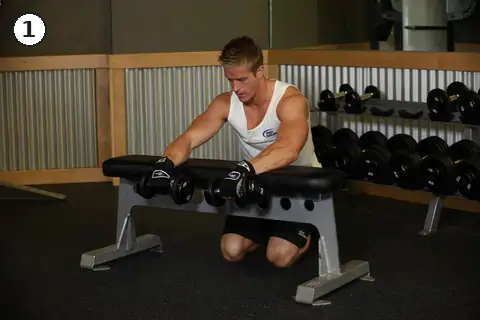

# Handgelenk-Strecken

> Unterarme auf der Bank, Handflächen nach unten. Nur die Handgelenke heben und senken. Gut gegen Ellbogenbeschwerden.

- **Muskeln/Bereich:** Unterarme (Strecker)
- **Equipment:** Kurzhanteln, Bank
- **Kategorie:** Arme
- **Erfassung:** Gewicht und Wiederholungen, Steigerung 1 kg
- **Hantel:** zwei Kurzhanteln
