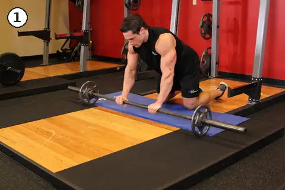

# Rollout kniend

> Nur so weit rollen, wie der Rücken gerade bleibt.

- **Muskeln/Bereich:** Core (Anti-Streckung)
- **Equipment:** Langhantel, Unkonventionell
- **Kategorie:** Core
- **Erfassung:** Körpergewicht, Wiederholungen

## Ausführung

- Kniend, Hände schulterbreit an der Stange.
- Becken leicht eingerollt, Bauch fest.
- Nur so weit rollen, wie der Rücken gerade bleibt.
- Mit Bauchspannung zurückziehen.

## Häufige Fehler

- Hohlkreuz am weitesten Punkt.

## Atmung

Einatmen beim Rausrollen, ausatmen beim Zurückkommen.

## Wo du es spürst

Bauch.

## Kommt vor in

- [Kraft C](../ablaeufe/kraft-c.md)
- [Vorlage Core Stabilität](../ablaeufe/vorlagen/x-core1.md)
- [Skill Rollout mit der Langhantel, Stufe 1](../skills/rollout.md)
- [Skill Rollout mit der Langhantel, Stufe 2](../skills/rollout.md)
- [Skill Rollout mit der Langhantel, Stufe 3](../skills/rollout.md)
- [Skill Rollout mit der Langhantel, Stufe 4](../skills/rollout.md)
- [Skill Rollout mit der Langhantel, Stufe 5](../skills/rollout.md)
