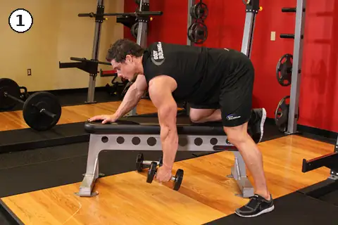

# Einarmiges Rudern

> Knie und Hand auf der Bank, Ellbogen Richtung Hüfte ziehen.

- **Muskeln/Bereich:** Rücken
- **Equipment:** Kurzhanteln, Bank
- **Kategorie:** Rücken
- **Erfassung:** Gewicht und Wiederholungen, Steigerung 2 kg
- **Pro Seite** ausführen

## Ausführung

- Knie und Hand der gleichen Seite auf der Bank, Rücken flach.
- Arm hängt gestreckt senkrecht unter der Schulter.
- Ellbogen nah am Körper Richtung Hüfte ziehen.
- Oben Schulterblatt zur Wirbelsäule, langsam ablassen.

## Häufige Fehler

- Oberkörper dreht auf.
- Mit dem Bizeps statt dem Rücken ziehen.

## Atmung

Ausatmen beim Ziehen.

## Wo du es spürst

Rücken und hintere Schulter.

## Kommt vor in

- [Kraft B · Beine](../ablaeufe/kraft-b.md)
