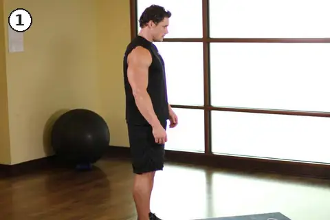

# Läufer-Dehnung

> Aus dem Ausfallschritt das vordere Bein strecken, Hüfte nach hinten, Rücken lang.

- **Muskeln/Bereich:** Beinbeuger, Wade
- **Equipment:** Körpergewicht
- **Kategorie:** Mobility
- **Erfassung:** Sekunden (Halten)

## Kommt vor in

- [Mobility nach Gefühl: Oberschenkel hinten](../mobility/koerperbereiche.md)
